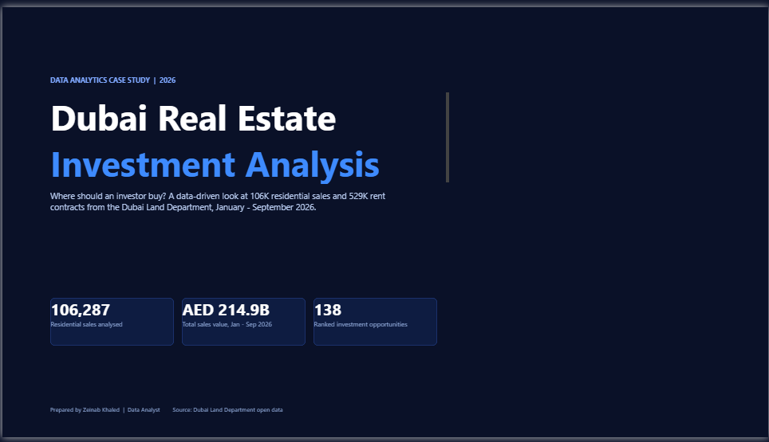
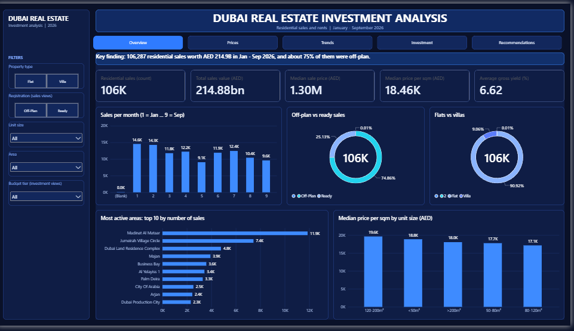
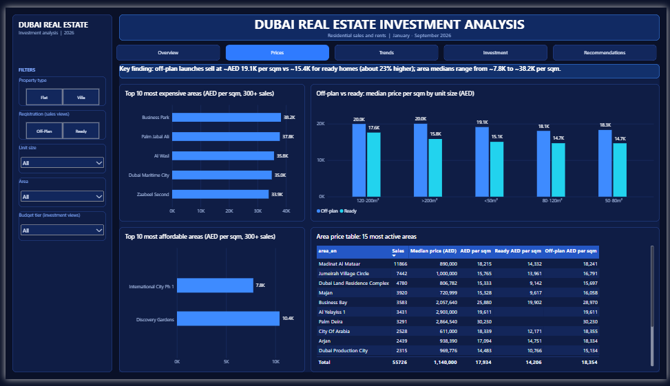
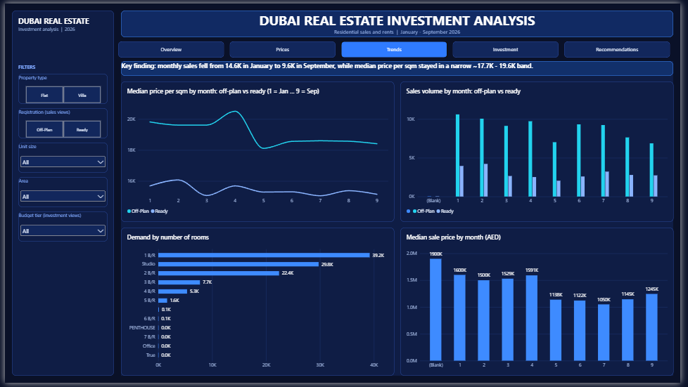
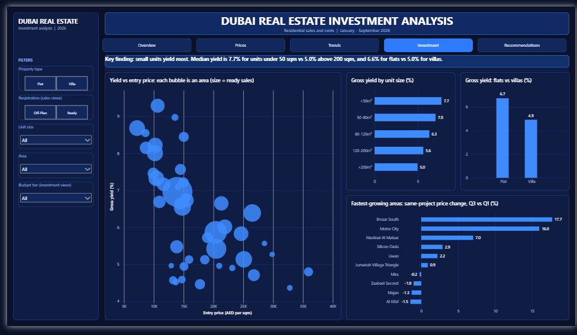
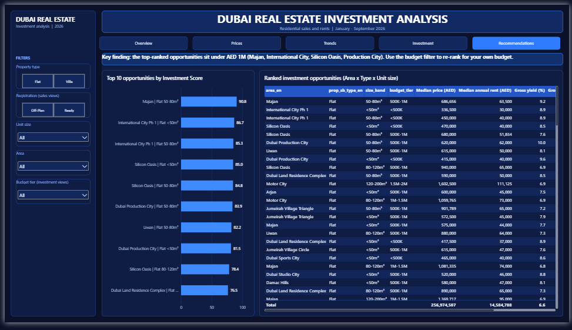

# Where Should an Investor Buy in Dubai?

> **A data-driven investment case study built on real Dubai Land Department data (Jan – Sep 2026) with Python and Power BI.**



---

## 📌 Executive Summary

A first-time investor wants to buy residential property in Dubai and asks: **which areas, property types and unit sizes offer the best mix of rental yield, price momentum and market liquidity?**

I analysed **106,287 residential sales (AED 214.9B)** and **529,165 rent contracts** from the Dubai Land Department, cleaned them with Python, and ranked **138 Area × Property Type × Unit Size combinations** with a transparent *Investment Score*. The results are delivered in an interactive Power BI dashboard.

**What the data says**

- **Off-plan dominates the market:** 74.9% of sales are off-plan, sold at a median **AED 19.1K/sqm vs 15.4K for ready homes (+23%)**.
- **Small units yield the most:** median gross yield is **7.7% for units under 50 sqm vs 5.0% above 200 sqm**, and **6.6% for flats vs 5.0% for villas**.
- **Yield and price momentum pull in opposite directions:** 6 of the top 10 opportunities show *falling* same-project prices (Q3 vs Q1), while the fastest-growing groups yield less.
- **The best balance:** Motor City flats (80–120 sqm, AED 1–1.5M) combine a **6.9% yield with +16% price growth**; Silicon Oasis flats combine **7–8.5% yield with +2.9%**.
- **Demand is cooling:** monthly sales fell **34%**, from 14,556 in January to 9,603 in September.

---

## 🎯 Business Problem

Dubai property is a high-value, fast-moving market, and investors often decide using headline prices or marketing material. A buyer needs to compare **what a property costs, what it earns in rent, how its price is moving, and how easy it is to trade**, using real registered transactions instead of listings.

### Business Questions

1. Which areas are the most expensive and the most affordable (price per sqm)?
2. How do off-plan and ready prices differ?
3. Which areas, property types and unit sizes offer the strongest rental yields?
4. How have sales volume and prices changed month to month?
5. Where is the market most active (liquidity)?
6. Which areas show price growth, and does growth come with a lower yield?
7. For a given budget, which areas should an investor shortlist?

---

## 📊 Dataset

| Item | Detail |
|---|---|
| **Source** | [Dubai Land Department – Real Estate Data (open data)](https://dubailand.gov.ae/en/open-data/real-estate-data/) |
| **Datasets used** | Transactions and Rents |
| **Period analysed** | 1 January – 30 September 2026 (October is partial and excluded) |
| **Scope** | Residential **Flats and Villas**, **sales only** (mortgages and gifts excluded) |
| **Sales after cleaning** | 106,287 transactions |
| **Rent contracts after cleaning** | 529,165 single-property contracts |

> The raw DLD downloads are not stored in this repository (size and licensing). See [Reproduce this project](#-reproduce-this-project). Please check the DLD terms of use before reusing the data.

---

## 🔄 Approach (Google Data Analytics framework)

### 1. ASK

- **Stakeholder:** a first-time investor and the advisory firm serving them.
- **Decision to support:** shortlist areas and unit types for a given budget.
- **Success criterion:** an investor can pick 3 shortlisted options, backed by yield, momentum and liquidity.

### 2. PREPARE

- Downloaded **Transactions** (one file) and **Rents** (three non-overlapping date ranges) from the DLD portal.
- Reviewed columns, date ranges, transaction groups, usage types and area naming in both datasets.
- Found that **rent and sales datasets name areas differently** (e.g. municipality vs marketing names), so rents cannot be joined to sales by area name alone.

### 3. PROCESS (Python)

All cleaning is reproducible in one script: [`scripts/build_powerbi_tables.py`](build_powerbi_tables.py). It logs the row count after every step and **stops with an error if a quality rule is broken**.

**Sales cleaning**

| Step | Rows |
|---|---:|
| Raw rows | 171,028 |
| Jan – Sep 2026 only | 165,173 |
| Group = Sales (no Mortgages / Gifts) | 123,530 |
| Usage = Residential | 120,284 |
| Sub type = Flat or Villa | **106,287** |
| Flagged as price-per-sqm outlier (kept, excluded from prices) | 2,128 |
| Flagged as partial-share sale (kept, excluded from prices) | 662 |

**Rents cleaning**

| Step | Rows |
|---|---:|
| Raw rows (all files) | 882,202 |
| Jan – Sep 2026 only | 843,829 |
| Usage = Residential | 647,067 |
| Flat or Villa (Studio counted as Flat) | 560,415 |
| Annual rent > 0 and area > 0 | 560,414 |
| Single-property contracts only | **529,165** |
| Flagged as outlier (excluded from yield) | 10,384 |

**Linking rents to sales areas** (a crosswalk was built and reviewed, in [`data/processed/area_crosswalk.csv`](area_crosswalk.csv)):

| Matched by | Contracts | Share |
|---|---:|---:|
| Exact name | 93,399 | 17.7% |
| Shared project | 165,396 | 31.3% |
| Reviewed crosswalk (≥ 80% of projects agree) | 101,024 | 19.1% |
| Unmapped (excluded from yield) | 169,346 | 32.0% |

### 4. ANALYZE

**Price per sqm** = sale value ÷ actual area. All price statistics use the **median** (robust to extreme values). Outliers (outside P1–P99 of their property type) and partial-share sales are excluded from price per sqm.

**Gross rental yield** = median annual rent ÷ median **Ready** sale price, per *Area × Property Type × Unit Size*.

- Off-plan sales are excluded from yield (no tenants yet).
- A group needs **≥ 30 Ready sales and ≥ 30 rent contracts**.
- Yields outside **2–12%** are treated as data errors and dropped.

**Price growth** = median same-project change in price per sqm, **Q3 vs Q1** (Ready sales; a project needs ≥ 5 sales in both quarters; a group needs ≥ 2 such projects).

**Investment Score (0–100)** = 40% yield + 30% growth + 30% market activity (each as a percentile rank).

**From raw groups to the final ranking**

| Funnel | Groups |
|---|---:|
| Groups with both Ready sales and rents | 433 |
| With ≥ 30 sales and ≥ 30 rents | 168 |
| Gross yield within 2–12% | 166 |
| With same-project growth (**final ranking**) | **138** (45 areas) |

**Sensitivity check:** the weights are a modelling choice, so the ranking was re-computed with a yield-heavy (50/20/30) and an equal-weight score. **9 of the top 10 stay the same under both** (rank correlation 0.98 and 0.99).

### 5. SHARE (Power BI)

An interactive dashboard with a cover page and six views, navigated with tabs, plus filters for property type, registration (ready / off-plan), unit size, area and budget tier.

| View | Question it answers |
|---|---|
| **Overview** | How big is the market and how is it split? |
| **Prices** | Where is it expensive or affordable? Off-plan vs ready? |
| **Trends** | How do volume and prices move month to month? |
| **Investment** | Which areas combine yield and entry price? |
| **Recommendations** | Ranked opportunities for a chosen budget |
| **About** | Method, definitions and limitations |







🎥 **Demo:** [Watch the project walkthrough](images/WhatsApp Video 2026-10-21 at 8.45.57 AM)

### 6. ACT

**Top 10 opportunities by Investment Score**

| # | Area | Type | Size | Median price (AED) | Gross yield | Growth Q3 vs Q1 | Score |
|--:|---|---|---|---:|---:|---:|---:|
| 1 | Majan | Flat | 50–80 sqm | 686,656 | 9.3% | −1.3% | 90.8 |
| 2 | International City Ph 1 | Flat | < 50 sqm | 336,500 | 8.9% | −4.2% | 86.7 |
| 3 | International City Ph 1 | Flat | 50–80 sqm | 450,000 | 8.9% | −4.2% | 85.3 |
| 4 | Silicon Oasis | Flat | < 50 sqm | 470,000 | 8.5% | +2.9% | 85.0 |
| 5 | Silicon Oasis | Flat | 50–80 sqm | 680,000 | 7.6% | +2.9% | 84.8 |
| 6 | Dubai Production City | Flat | 50–80 sqm | 620,000 | 10.0% | −4.5% | 83.9 |
| 7 | Liwan | Flat | 50–80 sqm | 615,000 | 8.1% | +2.2% | 82.2 |
| 8 | Dubai Production City | Flat | < 50 sqm | 415,000 | 9.6% | −4.5% | 81.5 |
| 9 | Silicon Oasis | Flat | 80–120 sqm | 940,000 | 6.9% | +2.9% | 78.4 |
| 10 | Dubai Land Residence Complex | Flat | 50–80 sqm | 590,000 | 8.5% | −5.1% | 76.5 |

**Recommendations by investor profile**

| Investor goal | What the data supports | Watch out for |
|---|---|---|
| **Rental income** (maximise yield) | Dubai Production City 50–80 sqm flats (10.0%), Majan 50–80 sqm flats (9.3%), International City Ph 1 flats (8.9%) | All three show falling same-project prices (−1% to −5%) |
| **Balanced** (yield + momentum) | Silicon Oasis flats (7–8.5% yield, +2.9%), Liwan flats (8.1%, +2.2%), **Motor City 80–120 sqm flats (6.9%, +16%)** | Growth is a 2-quarter measure, not a trend |
| **Growth** (price appreciation) | Emaar South villas (+17.7%), Jumeirah Village Circle 120–200 sqm villas, AED 2–3M (+12.3%) | Lower yield (4.6% and 6.1%) |
| **Budget above AED 3M** | Yields compress to about 5–6% (e.g. Burj Khalifa flats 6.3%, Dubai Hills villas 5.8%) | Fewer sales to benchmark against |

**Rule of thumb for the shortlist:** use the Budget filter, shortlist groups with **yield ≥ 6% and non-negative growth**, then prefer the ones with more Ready sales (higher liquidity).

---

## 💡 Key Insights

1. **Off-plan is three quarters of the market** (74.9% of sales) and sells at a **23% premium per sqm** over ready homes (AED 19,054 vs 15,449).
2. **Entry prices vary almost 5x across areas:** among the 66 areas with 300+ sales, median price per sqm ranges from AED 7,753 (International City Ph 1) to 38,213 (Business Park).
3. **Smaller is better for yield:** median yield falls steadily with size, from 7.7% (< 50 sqm) to 5.0% (> 200 sqm). Flats beat villas (6.6% vs 5.0%).
4. **Yield is not momentum:** only **15%** of the ranked groups show positive Q3-vs-Q1 price growth, and the highest-yield groups are among the weakest on momentum.
5. **Sales volume cooled through the year:** 14,556 sales in January vs 9,603 in September (−34%), while median price per sqm stayed within AED 17.7K–19.6K.
6. **Activity is concentrated:** Madinat Al Mataar alone accounts for 11,866 sales (11% of the market), followed by Jumeirah Village Circle (7,442).

---

## ⚠️ Limitations

- **Gross yield only.** Service charges, fees, maintenance and vacancy are not included, so net yields are lower.
- **Nine months of data.** Growth compares Q3 with Q1 on Ready sales only; it indicates short-term momentum, not a long-term trend.
- **Rent-to-area matching is imperfect.** 32% of rent contracts could not be mapped to a sales area and are excluded from yield.
- **Off-plan prices** are developer launch prices and are not directly comparable to resale prices.
- **Medians hide quality differences** inside an area (building age, view, floor).
- Group-level results with samples close to the minimum (30) are indicative, not precise.
- **For educational purposes only. Not investment advice.**

---

## 🔁 Reproduce this project

1. Download the raw files from the [DLD portal](https://dubailand.gov.ae/en/open-data/real-estate-data/): **Transactions** (1 Jan – 11 Oct 2026, one file) and **Rents** (three non-overlapping date ranges). Save them in `data/raw/`.
2. Install the dependencies:
```bash
   pip install -r requirements.txt
```
3. Open `scripts/build_powerbi_tables.py` and edit the **CONFIG** section (`RAW_DIR`, `OUT_DIR` and the raw file names).
4. Run:
```bash
   python scripts/build_powerbi_tables.py
```
   The script writes the cleaned tables and `data_quality_log.csv`, and stops with an error if a quality rule is broken.
5. Open the Power BI file. Its data sources point to the author's local folder: use **Home → Transform data → Data source settings** (or edit the *Source* step) to point them to your `data/processed/` files.

---

## 📁 Repository Structure

```text
dubai-real-estate-investment-analysis/
│
├── data/
│   └── processed/
│       ├── fact_sales_powerbi.zip                    # cleaned sales (zipped, ~106K rows)
│       ├── fact_investment_yields_powerbi.csv        # yield, growth and scores per group
│       ├── dubai_investment_opportunities_2026.csv   # same table, sorted by score
│       ├── area_crosswalk.csv                        # rents area -> sales area mapping
│       └── data_quality_log.csv                      # row counts after every step
│
├── scripts/
│   └── build_powerbi_tables.py                       # full cleaning + analysis pipeline
│
├── power_bi/
│   └── Dubai_Real_Estate_Investment_Analysis_2026.pbix
│
├── images/                                           # dashboard screenshots
├── requirements.txt
├── .gitignore
└── README.md
```

---

## 🛠️ Tools

| Tool | Purpose |
|---|---|
| **Python** (pandas, numpy) | Cleaning, area matching, yield, growth and scoring |
| **Power BI** (DAX) | Interactive dashboard, bookmarks navigation, measures |
| **GitHub** | Documentation and portfolio |

---

## 👩‍💻 Author

**Zeinab Khaled**
Data Analyst | Business Information Systems Graduate

### 📫 Connect with Me

- **Portfolio:** https://zeinak112.github.io/my_portfolio/
- **LinkedIn:** https://www.linkedin.com/in/zeinab-khaled-9a5ab8416/
- **Email:** zeinak631@gmail.com

*Data source: Dubai Land Department open data. This project is not affiliated with the Dubai Land Department.*
